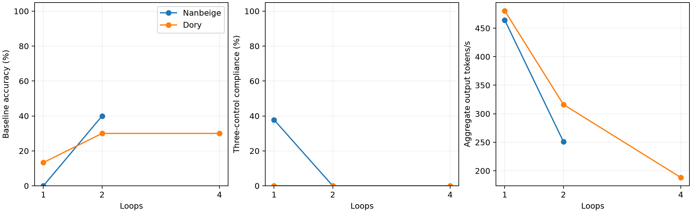

# Research Question

How do recurrence depth, GPQA accuracy, three-control CoT compliance, and runtime compare for Nanbeige at 1/2 loops and Dory at 1/2/4 loops?

# Setup

The same 30 questions from 427 keyword-annotated GPQA rows, seed 42, in each setting. Each has 30 baseline generations and 30 for each control: keyword suppression, string addition, and lowercase reasoning. Greedy decoding, BF16 weights and KV cache, 8,192 generated tokens, 16,384-token context, up to eight active sequences. Dory uses per-loop KV caching. Hardware: NVIDIA L40S, 46068 MiB, 595.91.07. This is the timing pilot, not a full evaluation.

- [Nanbeige, 1 loop](gpqa_nanbeige42_loops1_pilot.md): revision `b82e54bd609793562a75cbf9337970a93369eab5`, vLLM 0.30.0; [configuration](../../../results/gpqa30_seed42_nanbeige42_loops1_pilot8192/config.json), [summary](../../../results/gpqa30_seed42_nanbeige42_loops1_pilot8192/summary.json), effective model configuration and per-question outputs alongside them.
- [Nanbeige, 2 loops](gpqa_nanbeige42_loops2_pilot.md): revision `b82e54bd609793562a75cbf9337970a93369eab5`, vLLM 0.30.0; [configuration](../../../results/gpqa30_seed42_nanbeige42_loops2_pilot8192/config.json), [summary](../../../results/gpqa30_seed42_nanbeige42_loops2_pilot8192/summary.json), effective model configuration and per-question outputs alongside them.
- [Dory, 1 loop](gpqa_dory_loops1_pilot.md): revision `f6c832e6963ddb74f62c75813a3e8c74b1af67b1`, vLLM 0.33.0; [configuration](../../../results/gpqa30_seed42_dory_loops1_pilot8192/config.json), [summary](../../../results/gpqa30_seed42_dory_loops1_pilot8192/summary.json), effective model configuration and per-question outputs alongside them.
- [Dory, 2 loops](gpqa_dory_loops2_pilot.md): revision `f6c832e6963ddb74f62c75813a3e8c74b1af67b1`, vLLM 0.33.0; [configuration](../../../results/gpqa30_seed42_dory_loops2_pilot8192/config.json), [summary](../../../results/gpqa30_seed42_dory_loops2_pilot8192/summary.json), effective model configuration and per-question outputs alongside them.
- [Dory, 4 loops](gpqa_dory_loops4_pilot.md): revision `f6c832e6963ddb74f62c75813a3e8c74b1af67b1`, vLLM 0.33.0; [configuration](../../../results/gpqa30_seed42_dory_loops4_pilot8192/config.json), [summary](../../../results/gpqa30_seed42_dory_loops4_pilot8192/summary.json), effective model configuration and per-question outputs alongside them.

# Factual Observations

| Model | Loops | Baseline accuracy | Compliance | Excluding meta | Compliant + correct | Truncated | Missing answer | Minutes | Tokens/s |
|---|---:|---:|---:|---:|---:|---:|---:|---:|---:|
| Nanbeige | 1 | 0.0% | 37.8% | 35.6% | 0/90 | 120/120 | 120/120 | 35.3 | 464.2 |
| Nanbeige | 2 | 40.0% | 0.0% | 0.0% | 0/90 | 62/120 | 62/120 | 52.7 | 251.1 |
| Dory | 1 | 13.3% | 0.0% | 0.0% | 0/90 | 101/120 | 101/120 | 32.1 | 480.5 |
| Dory | 2 | 30.0% | 0.0% | 0.0% | 0/90 | 82/120 | 82/120 | 46.2 | 316.2 |
| Dory | 4 | 30.0% | 0.0% | 0.0% | 0/90 | 81/120 | 81/120 | 76.8 | 188.3 |

Compliance averages the three controls regardless of correctness. Runtime depends on each setting's actual output lengths; the CSV records total and mean generated tokens. Runtime and throughput exclude startup/compilation and judge calls; interrupted generation time is included. Missing final answers count as incorrect. All 600 generations and required meta-discussion judgments are saved. **446/600 (74.3%)** generations hit the output cap. The figure connects observed settings without interpolating untested settings. [Numeric table](gpqa_requested_pilots_comparison.csv).

# Message

At 1/2 loops, Nanbeige's baseline accuracy was 0.0%/40.0%, and formal three-control compliance was 37.8%/0.0%. At 1/2/4 loops, Dory's baseline accuracy was 13.3%/30.0%/30.0%, and formal three-control compliance was 0.0%/0.0%/0.0%. Nanbeige at 1 loop produced no extracted final answer in any of its 120 generations; its formal compliance score does not demonstrate usable controlled problem solving. Dory at two and four loops had equal baseline accuracy on this sample, while full-pilot generation took 46.2 and 76.8 minutes respectively. Formal string/case compliance can be satisfied by repetitive or unfinished text; the joint compliant-and-correct count helps expose this limit. These are descriptive results from one paired sample, not evidence of a general monotonic trend. Thirty questions, a single seed, the token cap, and different architectures and inference implementations limit generalization. Equal loop counts do not imply equal compute across models. The three-control score is not the paper's nine-control aggregate. Full-scale evaluation remains on hold.
