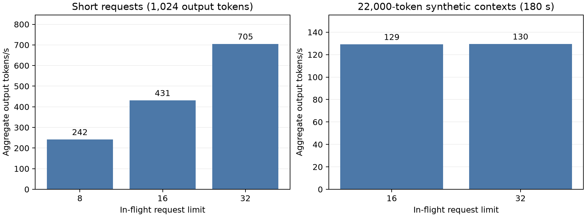

# Research Question

How can the existing GPQA pipeline use this single NVIDIA L40S more effectively before full Dory evaluation at 4, 2, then 1 loops?

# Setup

Pinned Dory BF16 model and vLLM 0.33.0, four loops, per-loop BF16 KV caching, 28,160-token context, 95% GPU memory allocation, chunked prefill (8,192-token budget), prefix caching, asynchronous scheduling, and compiled CUDA graphs. The same 32 prepared question/condition requests were used at in-flight limits 8/16/32. Short tests force exactly 1,024 output tokens and ignore EOS. Separate stress tests repeat input token sequences to 22,000 tokens and run for 180 seconds, with a 4,096-token decode ceiling. These are **performance-only tests**, not accuracy/compliance evaluation; no test output is reused in the full run. Startup and warmup are excluded.

The full preflight checked all **4,414 requests per setting**: 445 baseline questions and 445 per control except the two keyword conditions, which have 427 each. The original pinned CoTControl local settings are **25,000 total generated tokens**, temperature 0 and top-p 1 (`run_cceval.py:43,469-470`, `llm.py:491-495`). Maximum prompt length is **3,055 tokens**, leaving the complete output budget within 28,160 tokens. All prepared requests use one frozen tokenizer/model revision and input hash. The source has one duplicate-answer row (74, A/B); upstream's own resolver selects A. No question is excluded or rewritten.

# Factual Observations

| Workload | Limit | Output tokens | Seconds | Tokens/s | Sampled peak KV | Preemptions |
|---|---:|---:|---:|---:|---:|---:|
| Short | 8 | 32,768 | 135.5 | 241.8 | 9.2% | 0 |
| Short | 16 | 32,768 | 76.0 | 431.1 | 17.1% | 0 |
| Short | 32 | 32,768 | 46.5 | 705.0 | 35.0% | 0 |
| Long context | 16 | 23,255 | 180.0 | 129.2 | 88.3% | 0 |
| Long context | 32 | 23,327 | 180.1 | 129.6 | 88.3% | 0 |

The short-request throughput ratios relative to limit 8 are **1.78×** at 16 and **2.92×** at 32. Long-context throughput is essentially the same at 16 and 32: vLLM admits roughly twelve long requests and queues the rest. No preemptions occurred during these bounded tests. KV values are periodic samples, not a proof of worst-case memory headroom. Timed long-context tests end before requests finish; their throughput includes prefill and partial decode tokens.

The first 64 generated token IDs match the limit-8 run for **24/32** requests at limit 16 and **21/32** at limit 32. Batching changes BF16 numerical execution and can change greedy text; these configurations are **not bitwise equivalent**, even though temperature, top-p, model weights and precision match. Full runs use the same limit 32 across all loop settings and record execution settings.

The audit also found and fixed: (1) an O(file-size) journal reread for every append, now a one-byte normal-tail check with bounded crash repair; (2) Unicode paragraph separators incorrectly splitting JSONL text records, now read as byte-delimited records; (3) the pilot-only unique-answer assertion that would abort on row 74, now using upstream's resolver; and (4) full-mode CLI output defaults that could select pilot directories, bypassed by dedicated full-run paths. Sixteen tests passed, covering crash recovery, Unicode records, request identity, answer extraction, full input coverage, mixed-condition timing, live-judge retries, and the original full ignore-question/meta-discussion judging protocol.

# Message

Use **one GPU engine with up to 32 active sequences**, letting its KV-aware scheduler reduce concurrency as contexts grow. This improves short-request utilization without claiming a 2.92× speedup for the complete 25,000-token workload. Prefix caching reuses common question prefixes; it cannot eliminate long decode cost ([vLLM prefix caching](https://docs.vllm.ai/en/stable/features/automatic_prefix_caching/)). Keep asynchronous scheduling, compilation, and chunked prefill; no quantization or output-budget reduction is introduced ([vLLM tuning guide](https://docs.vllm.ai/en/stable/configuration/optimization/)). Running multiple model copies on one GPU would duplicate weights/cache and compete for the same device, so loop settings stay sequential in the requested **4 → 2 → 1** order.

The full runner uses one continuous queue across all ten conditions to avoid drain gaps, pre-tokenized frozen inputs, a separate durable output writer, and CPU/API grading alongside generation. Per-condition GPU times are not invented for an overlapping schedule; reports use measured per-setting wall time and token throughput. A local supervisor records PIDs, GPU telemetry and state, resumes saved questions on retries, stops on an explicit pause, and writes each report when grading is complete. With **13,242 generations** and a maximum of **331,050,000 output tokens**, this is a multi-day workload on one L40S; completion time depends on actual output lengths and long-context cache pressure. Later preemptions remain possible and are recorded.

[Raw benchmark summary](../results/dory_pipeline_audit/summary.json) · [Benchmark code](../scripts/benchmark_dory_pipeline.py) · [Frozen full-run plan](../results/dory_full_inputs/plan.json) · [Supervisor](../scripts/run_dory_full.py).
