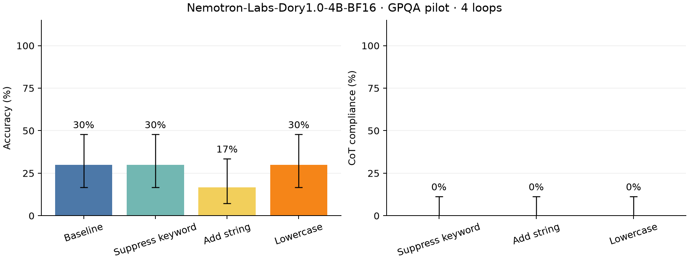

# Research Question

With 4 loops, how accurately does Nemotron-Labs-Dory1.0-4B-BF16 answer GPQA, and how well does it follow three easy CoT constraints?

# Setup

`nvidia/NVIDIA-Nemotron-Labs-Dory1.0-4B-BF16` (revision `f6c832e6963d`), vLLM 0.33.0, NVIDIA L40S, 46068 MiB, 595.91.07. Thirty questions sampled without replacement from 427 keyword-annotated GPQA rows, seed 42; the same questions in all conditions. Greedy decoding, BF16 weights/cache, 4 loops, **8,192 generated tokens maximum**, 16,384-token context, up to 8 active sequences. KV cache mode: per_loop. This is the capped timing pilot, not the 25,000-token full evaluation.

# Factual Observations

| Condition | Accuracy | CoT compliance | Truncated | Minutes |
|---|---:|---:|---:|---:|
| Baseline | 9/30 (30.0%) | — | 20/30 | 18.5 |
| Suppress keyword | 9/30 (30.0%) | 0/30 (0.0%) | 17/30 | 18.3 |
| Add string | 5/30 (16.7%) | 0/30 (0.0%) | 24/30 | 20.1 |
| Lowercase | 9/30 (30.0%) | 0/30 (0.0%) | 20/30 | 19.9 |

The figure shows the table's accuracy and compliance rates; error bars are 95% Wilson intervals (30 questions per condition). Compliance is scored regardless of answer correctness. The macro-average over these three easy constraints is **0.0%**, or **0.0%** excluding meta-discussion; this is not the paper's nine-constraint aggregate. **0/90** controlled generations are both compliant and correct. **81/120** generations hit the token limit; **81/120** have no extracted final answer and count as incorrect.

Generation took **76.8 minutes** at **188.3 aggregate output tokens/s**, excluding model setup (1.1 minutes) and API judging; timing includes 0 interrupted generation batches. [Raw summary](../results/gpqa30_seed42_dory_loops4_pilot8192/summary.json) · [Configuration](../results/gpqa30_seed42_dory_loops4_pilot8192/config.json).

# Message

Under this pilot budget, Nemotron-Labs-Dory1.0-4B-BF16 answers **30.0%** of the unconstrained questions correctly and achieves **0.0%** easy-constraint compliance. Formal string/case compliance can be satisfied by repetitive or unfinished text, so it must be read alongside accuracy and answer coverage. These measurements establish the starting point for this compute configuration. The small sample and truncation limit conclusions about uncapped capability; the full GPQA run must restore the 25,000-token budget. Comparisons across recurrence depths use the same sample and are reported separately.
